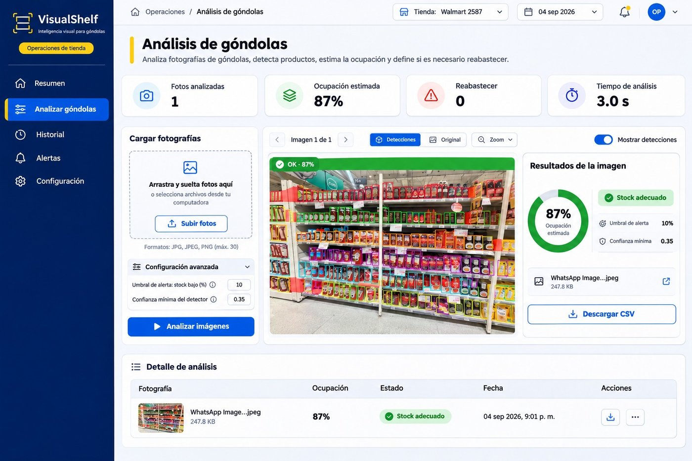
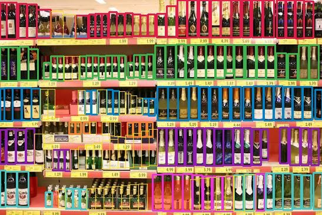
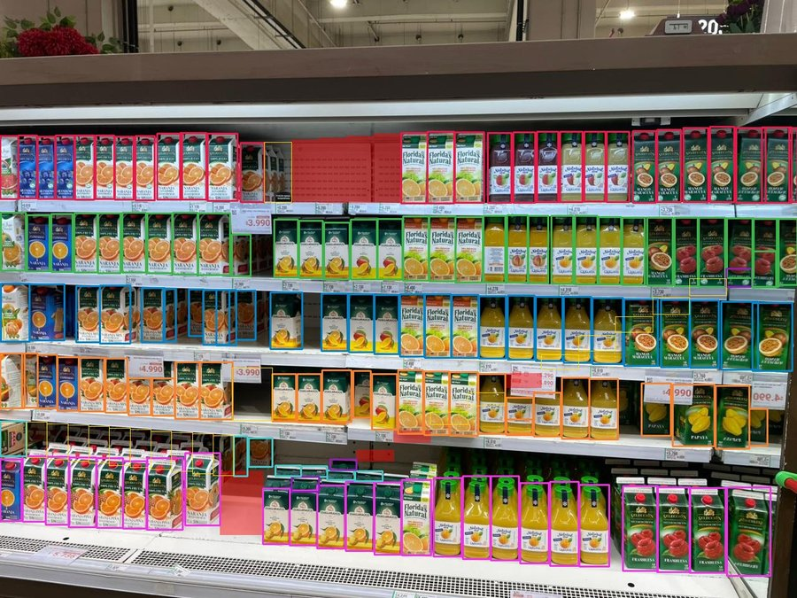
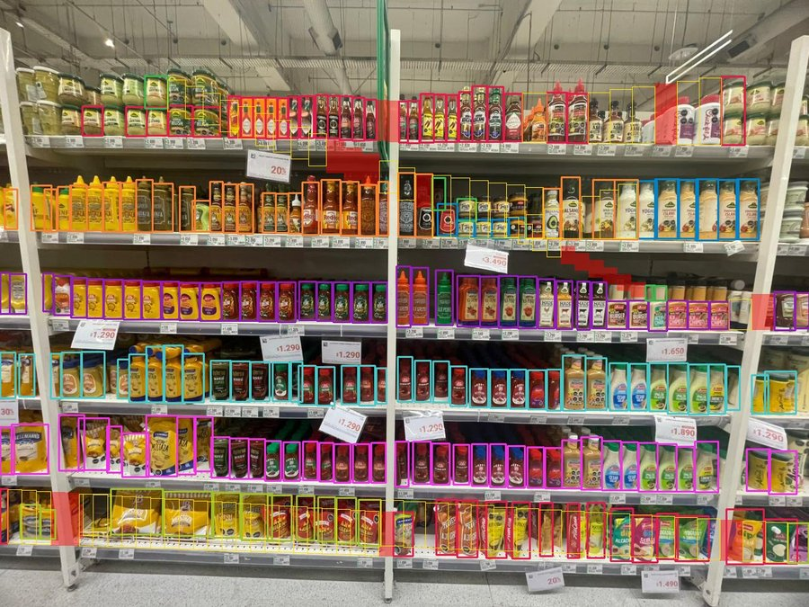
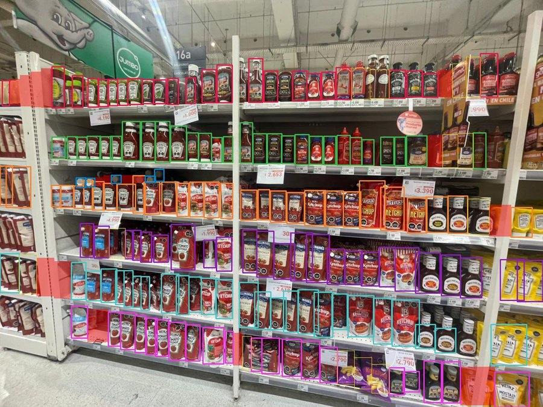
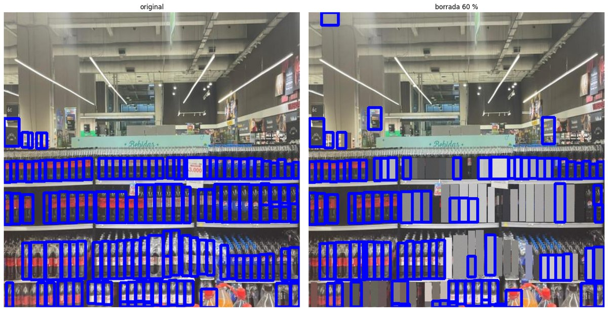
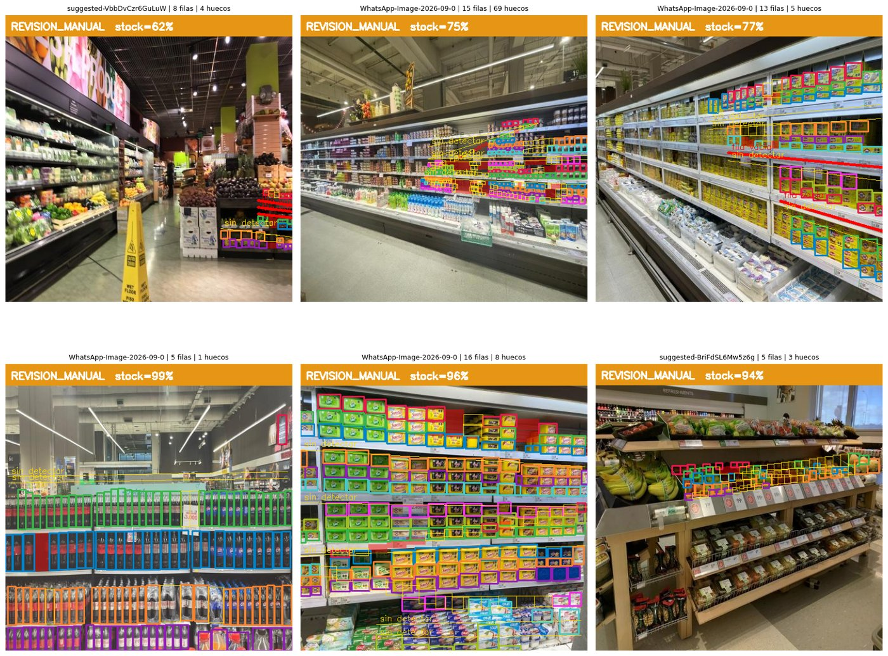

# VisualShelf — Detección de góndolas vacías con visión por computador

Proyecto Capstone (APT122) · Ingeniería en Informática · Duoc UC

VisualShelf analiza fotos de góndolas de supermercado, detecta cada producto con un modelo YOLOv8, estima el **porcentaje de stock** de la góndola y avisa **"Reabastecer"** cuando baja del umbral crítico (30 % por defecto).

<p align="center">
  
</p>

<!-- GIF de la app funcionando: grabarlo y dejarlo en docs/img/demo.gif -->
<!-- <p align="center"></p> -->

---

## Contenido

- [Problemática](#problemática)
- [Objetivos](#objetivos)
- [Cómo funciona](#cómo-funciona)
- [Resultados](#resultados)
- [La aplicación](#la-aplicación)
- [Instalación y ejecución](#instalación-y-ejecución)
- [Estructura del repositorio](#estructura-del-repositorio)
- [Estado del proyecto](#estado-del-proyecto)
- [Equipo](#equipo)

---

## Problemática

En el retail, revisar a mano qué góndolas se están quedando sin productos es lento, costoso y difícil de escalar entre salas y locales. Cuando la revisión llega tarde, el producto falta en la góndola aunque exista en bodega (quiebre de stock en sala), con pérdida de ventas y una peor experiencia para el cliente.

## Objetivos

**General:** diseñar e implementar una solución basada en inteligencia artificial y visión por computador que analice imágenes de góndolas, determine la disponibilidad visual de productos y emita alertas cuando sea inferior a un umbral crítico (por ejemplo, 30 %).

**Específicos:**

1. Detectar los productos y las repisas de la góndola usando YOLOv8.
2. Determinar los espacios libres entre productos, con un filtro de separación natural, para identificar huecos y calcular el porcentaje de stock.
3. Manejar zonas obstruidas o poco confiables (personas, carros, pilares o reflejos) para no generar alertas falsas.
4. Evaluar el sistema con métricas cuantitativas (mAP, precisión, recall y tiempos de procesamiento).
5. Garantizar la reproducibilidad del proyecto con un repositorio ordenado y documentación de ejecución.

---

## Cómo funciona

```text
Foto de la góndola
      │
      ▼
Detector YOLOv8s (clase única "producto")  ──►  cajas de cada producto
      │
      ▼
Filas de la góndola (RANSAC sobre la base de los productos)
      │
      ▼
Huecos: espacio > 1,3 × ancho de los vecinos  +  verificación de textura
      │
      ▼
% de stock por fila y por góndola
      │
      ▼
Estado:  Stock adecuado  │  Reabastecer (< umbral)  │  Revisión manual
```

- **Detector:** YOLOv8s entrenado con SKU-110K (1.500 imágenes) más los datasets de Kaggle `humansintheloop/supermarket-shelves-dataset` y `unidpro/grocery-shelves`, convertidos a formato YOLO con una sola clase `producto` (se descartan las etiquetas de precio). Confianza de detección: 0,35.
- **Filas:** se obtienen de la posición de los productos detectados (RANSAC), sin un modelo de segmentación aparte.
- **Separación natural:** un espacio solo cuenta como hueco si es más ancho que 1,3 veces sus productos vecinos y además no tiene textura de producto. Las filas vacías se infieren y también se verifican por textura.
- **Revisión manual:** cuando el resultado no es confiable (foto ilegible, muy pocos productos, zonas dudosas), la foto no se marca como alerta, sino como "Revisión manual", para no dar falsas alarmas.
- **Robustez:** el entrenamiento usa aumentación con fallas simuladas (reflejos, desenfoque, ruido, píxeles muertos, cambios de brillo y perspectiva).

<p align="center">
  
  
</p>
<p align="center">
  
  
</p>
<p align="center"><em>Fotos propias analizadas: cada caja es un producto detectado; el color indica la fila.</em></p>

---

## Resultados

**Detector (160 imágenes de validación):**

| Métrica | Resultado |
|---|---|
| Precisión | 0,897 |
| Recall | 0,860 |
| mAP50 | 0,912 |

**Sistema completo con 44 fotos propias de góndolas llenas:** 42 en "Stock adecuado", 2 en "Revisión manual" y **0 falsas alarmas**.

**Simulación de faltantes:** se borran productos de fotos reales y se comprueba que la ocupación baja y que aparece la alerta (84 % de las alertas detectadas en simulación).

<p align="center">
  
</p>

**Plan de pruebas de la app:** 51 casos; en la primera ejecución pasaron 39, falló 1 y quedaron 11 pendientes.

**Pendiente:** medir el error del % de stock y el acierto de la alerta con fotos reales de góndolas con poco stock.

<details>
<summary>Galería de fotos propias analizadas</summary>
<p align="center"></p>
</details>

---

## La aplicación

La aplicación web está en [`Desarrollo/app`](Desarrollo/app):

- Inicio de sesión con Supabase Auth y permisos por tienda (roles `admin` y `operador`).
- Carga de hasta 30 fotos por análisis, por botón o arrastrando.
- Visor con detecciones, zoom y vista original.
- Panel con ocupación, estado, productos, huecos y filas.
- Historial compartido por tienda, alertas, resumen por tienda y exportación a CSV.
- Fotos guardadas en Storage privado de Supabase.
- Reentrenamiento del modelo con fotos propias (`entrenar.py`).

**Tecnologías:** Python 3.11, Ultralytics YOLOv8, PyTorch, OpenCV, NumPy, SciPy y Pillow. El servidor usa la biblioteca estándar de Python (`http.server`), sin frameworks. La interfaz está hecha en HTML, CSS y JavaScript sin dependencias. Supabase aporta Auth, PostgreSQL con RLS y Storage. Se puede ejecutar en local, en Docker o en Google Colab.

---

## Instalación y ejecución

```bash
git clone https://github.com/Nico-Cartes-dev/Visual-shelf.git
cd Visual-shelf/Desarrollo/app
python -m venv venv
# Windows: .\venv\Scripts\activate   |   Linux/macOS: source venv/bin/activate
python -m pip install -r requirements.txt
```

Configura `SUPABASE_URL` y `SUPABASE_PUBLISHABLE_KEY` (ver `.env.example`). En Windows, `iniciar.ps1` las configura e inicia la app:

```powershell
./iniciar.ps1
```

Luego abre http://127.0.0.1:7860. `best.pt` y `parametros_v4.json` deben estar junto a `app.py`; también puedes indicar otro modelo:

```bash
python app.py --modelo ruta/a/best.pt --puerto 7860
```

Más información:

- [`CENTRALIZACION.md`](Desarrollo/app/CENTRALIZACION.md): usuarios, permisos, Docker y publicación.
- [`ENTRENAMIENTO.md`](Desarrollo/app/ENTRENAMIENTO.md): reentrenar el modelo con fotos propias.

Pruebas:

```bash
python -m unittest test_central test_entrenar -v
node test_frontend.cjs
```

**Reproducibilidad:** el notebook fija la semilla (`SEED = 42`) en `random`, NumPy y PyTorch, y respalda datos y pesos en Google Drive.

---

## Estructura del repositorio

```text
Visual-shelf/
├── README.md
├── docs/img/                   Imágenes de este README
├── Desarrollo/
│   ├── app/                    Aplicación VisualShelf
│   │   ├── app.py              Servidor y API
│   │   ├── motor.py            Detección y cálculo de stock (notebook V4.1b)
│   │   ├── central.py          Conexión con Supabase (Auth, PostgreSQL, Storage)
│   │   ├── static/             Interfaz web
│   │   ├── supabase/           Esquema SQL y pruebas de permisos
│   │   ├── entrenar.py         Reentrenamiento con fotos propias
│   │   ├── best.pt             Pesos del modelo
│   │   ├── parametros_v4.json  Parámetros calibrados
│   │   ├── Dockerfile
│   │   └── lanzar_app_colab.ipynb
│   └── requirements.txt
├── Fase 1/                     Diseño (casos de uso, mockups, arquitectura) y gestión (Gantt, RACI, riesgos)
└── Fase 2/                     Informes, diarios de reflexión y notebooks de modelos
```

---

## Estado del proyecto

| Módulo | Estado |
|---|---|
| Ingesta y conversión de datos a YOLO | Terminado |
| Detector de productos (YOLOv8s + SKU-110K) | Terminado: P 0,90 · R 0,86 · mAP50 0,91 |
| Cálculo de huecos, % de stock y alerta | Terminado |
| Aplicación web con login e historial compartido | Terminado; falta elegir dónde publicarla |
| Manual de usuario y plan de pruebas | Terminado; pruebas en curso |
| Validación con fotos reales de bajo stock | Pendiente |

---

## Equipo

| Integrante | Correo |
|---|---|
| Nicolás Cartes | ni.cartesg@duocuc.cl |
| Eric Flores | eri.flores@duocuc.cl |
| David Luengo | da.luengo@duocuc.cl |
| Luis Saldias | lu.saldiasv@duocuc.cl |

**Supervisores:** Arturo Vargas (arvargas@profesor.duoc.cl) y José Larraín.
